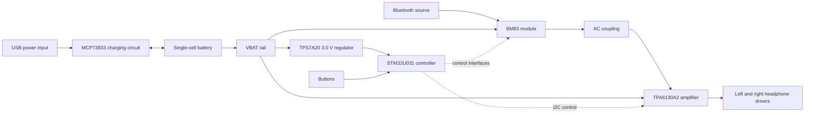

# Bluetooth Headphones

An ongoing electronics project by **Jonathan Molla** to develop custom Bluetooth headphones, covering circuit design, PCB layout, STM32 control configuration, and audio-path simulation.

**Status: design and simulation stage.** This repository documents a work in progress. The PCB files are not a manufacturing release, and assembled-hardware performance has not been verified. The firmware folder currently contains an STM32CubeMX configuration, not a working firmware application.


## Project at a glance

| Area | Implementation in this repository |
| --- | --- |
| Bluetooth audio | Microchip BM83 module in the KiCad audio schematic |
| Headphone amplifier | TI TPA6130A2, with AC-coupled analog inputs |
| Controller | STM32U031C8T6 configuration and MCU/button schematic |
| Charging | MCP73833 circuit on a separate power PCB |
| Regulation | TPS7A2030PDBVR, fixed 3.0 V regulator |
| Design tools | KiCad, STM32CubeMX, LTspice |
| Simulation scope | Simplified analog coupling and voltage-gain models |

## Start here

- **See the design:** [schematic previews](docs/schematics/) and [PCB previews](docs/images/).
- **Understand the engineering:** [architecture and design decisions](docs/design.md).
- **Review the evidence:** [validation status and next tests](docs/validation.md).
- **Open the source:** [setup instructions](docs/getting-started.md).
- **See what is next:** [roadmap](docs/roadmap.md).
- **Inspect component lists:** [main board](hardware/main/bom.csv) and [power board](hardware/power/bom.csv). These are schematic-derived lists, not finalized purchasing BOMs.

## System architecture



This is an architectural overview. Exact connections and component values are defined by the native schematics. The main/audio board and charging/power board are separate KiCad projects.

## Engineering work represented

- Hierarchical schematic organization for audio and MCU controls.
- A separate charging and regulation PCB.
- Project-local symbols and footprints alongside the native KiCad files.
- Analog audio coupling modeled with explicit assumptions and limitations.
- STM32 pin and peripheral configuration captured in a reproducible `.ioc` file.
- A validation plan that separates design checks, simulation, and future bench measurements.

## Repository layout

```text
hardware/
  main/          Main/audio PCB, hierarchical schematics and local libraries
  power/         Charging/regulation PCB, schematic and local libraries
firmware/        STM32CubeMX configuration and current implementation status
simulation/      LTspice schematic, symbols, simplified models and instructions
docs/
  images/        PCB layout previews
  schematics/    Browser-readable schematic exports
  checks/        Recorded KiCad design checks
```

## Current limitations

Board layout, design-rule review, firmware implementation, and physical validation remain part of the ongoing project. No measured battery runtime, output power, noise, distortion, acoustic response, or Bluetooth performance is claimed. Simulation models do not reproduce the full behavior of the BM83 or TPA6130A2.

## Author and references

Project owner: [Jonathan Molla](https://github.com/jonathanmolla).

See [references and third-party materials](docs/references.md) for component sources and [reuse information](NOTICE.md) before reusing the files.
