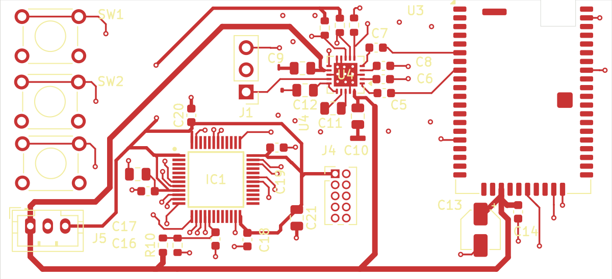
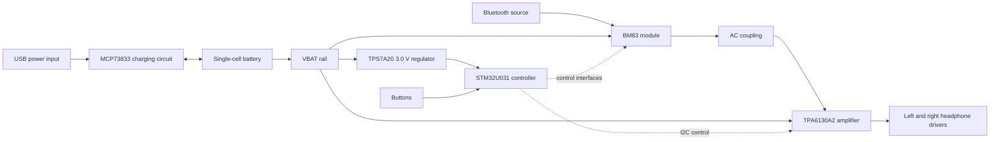

# Bluetooth Headphones

Custom Bluetooth headphone electronics by **Jonathan Molla**, bringing together stereo audio circuit design, PCB layout, battery charging, STM32 controller configuration, and LTspice simulation.



## Project at a glance

| Area | Implementation in this repository |
| --- | --- |
| Bluetooth audio | Microchip BM83 module in the KiCad audio schematic |
| Headphone amplifier | TI TPA6130A2, with AC-coupled analog inputs |
| Controller | STM32U031C8T6 configuration and MCU/button schematic |
| Charging | MCP73833 circuit on a separate power PCB |
| Regulation | TPS7A2030PDBVR, fixed 3.0 V regulator |
| Design tools | KiCad, STM32CubeMX, LTspice |
| Simulation scope | Simplified analog coupling and voltage-gain models |

## Explore the project

| What you want to see | Where to find it |
| --- | --- |
| **PCB layouts and editable board files** | [Main audio PCB](hardware/main/#main-audio-pcb) · [Charging and power PCB](hardware/power/#charging-and-power-pcb) |
| **Schematics** | [Audio, controller, and charging circuit diagrams](docs/schematics/) |
| **Board images** | [Main audio and power board previews](docs/images/) |
| **Circuit design and component choices** | [Architecture and design decisions](docs/design.md) |
| **STM32 configuration** | [Controller pin and peripheral configuration](firmware/) |
| **Audio simulation** | [LTspice circuit, models, and run instructions](simulation/) |
| **Component lists** | [Main audio board BOM](hardware/main/bom.csv) · [Power board BOM](hardware/power/bom.csv) |
| **Engineering checks** | [Schematic and PCB check results](docs/validation.md) |
| **Opening the design files** | [Software and setup guide](docs/getting-started.md) |
| **Design deliverables** | [Project file guide](docs/roadmap.md) |

## System architecture



This is an architectural overview. Exact connections and component values are defined by the native schematics. The main/audio board and charging/power board are separate KiCad projects.

## Engineering highlights

- Hierarchical schematic organization for audio and MCU controls.
- A separate charging and regulation PCB.
- Project-local symbols and footprints alongside the native KiCad files.
- Stereo AC-coupling analysis with parameterized input resistance, gain, and driver loads.
- STM32 pin and peripheral configuration captured in a reproducible `.ioc` file.
- Recorded KiCad electrical and design-rule checks with a structured measurement procedure.

## Repository layout

```text
hardware/
  main/          Main audio PCB, audio and controller schematics, local libraries
  power/         Charging and power PCB, schematic and local libraries
firmware/        STM32CubeMX controller configuration
simulation/      LTspice audio circuit, symbols, models and instructions
docs/
  images/        PCB layout previews
  schematics/    Browser-readable schematic exports
  checks/        Recorded KiCad design checks
```

## Author and references

Project owner: [Jonathan Molla](https://github.com/jonathanmolla).

See [references and third-party materials](docs/references.md) for component sources and [reuse information](NOTICE.md) before reusing the files.
