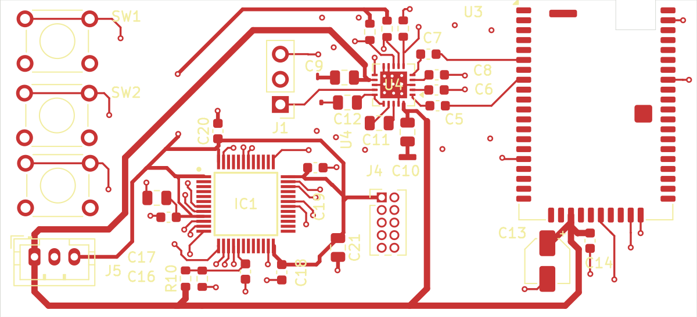
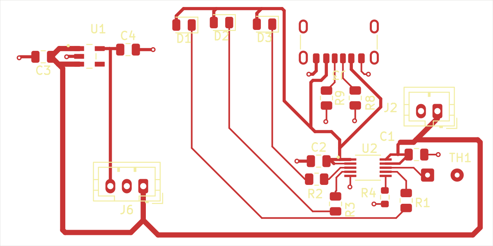

# PCB layout images

These previews show front copper, front silkscreen and the board outline. Open the linked native PCB file in KiCad to inspect every copper layer and board setting.

## Main audio PCB

[Open the main audio board files](../../hardware/main/) · [Editable PCB layout](../../hardware/main/Bluetooth%20Headphones%20Project.kicad_pcb)

## Charging and power PCB

[Open the charging and power board files](../../hardware/power/) · [Editable PCB layout](../../hardware/power/Charging%20and%20Power.kicad_pcb)
